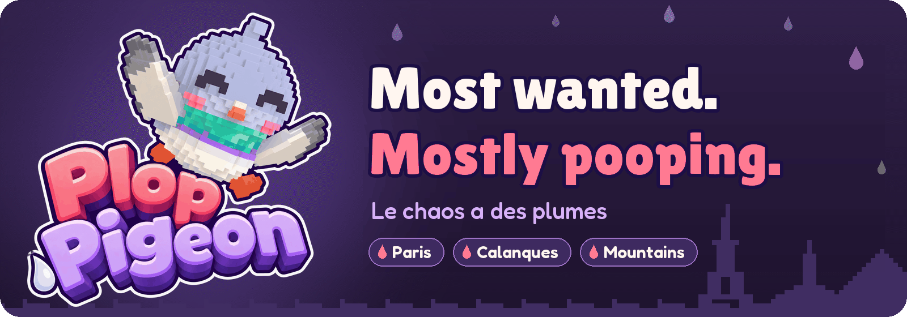
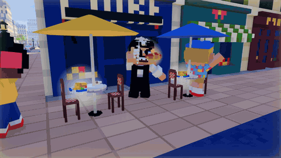
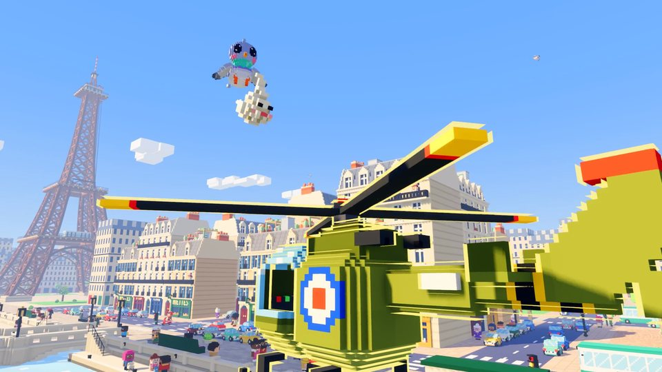
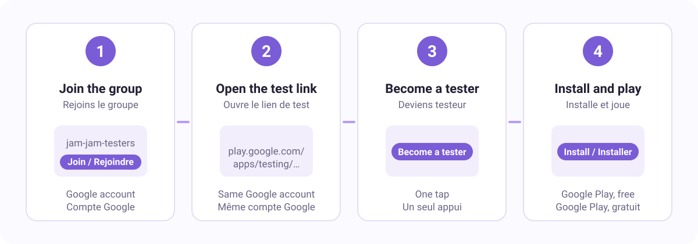

  

<h3 align="center">You are a cute pigeon. One poop starts a chain reaction. The whole city loses it.</h3>

  A voxel arcade game for phones and computers, cartoon and family friendly: nobody gets hurt, everyone gets back up (furious).

  <a href="#gameplay"><b>Gameplay</b></a> ·
  <a href="#why-youll-love-it"><b>Features</b></a> ·
  <a href="#en-français"><b>Français</b></a> ·
  <a href="https://studio-moutonneux.github.io/plop-pigeon/support/"><b>Support</b></a>
  <!-- Google Play link, to add once the game is published:
  · <a href="https://play.google.com/store/apps/details?id=com.moutonneux.pigeonchaos"><b>Get it on Google Play</b></a>
  -->

## Gameplay

  

<!-- Full trailer, to add once it is on YouTube:

<a href="https://www.youtube.com/watch?v=VIDEO_ID"><b>Watch the full trailer</b></a>

-->

  
  
  
   
  Paris · The Calanques · The Mountains

## Why you'll love it

- **One poop, a chain reaction.** A cyclist swerves, a car hits a hydrant, the whole café terrace gets soaked.
- **Most wanted.** The more chaos, the angrier the city: firefighters, police, then the army. Hide to cool things down.
- **Then it gets weird.** Keep the chaos going and the city answers with ever more absurd surprises.
- **Three maps.** The rooftops of Paris, the Calanques of Marseille and a snowy ski resort high in the mountains.
- **Easy to pick up.** Glide-style flight and auto lock-on, on a phone held upright or sideways.
- **Cartoon and kind.** Nobody gets hurt, and the old folks in the park are your friends: they share their bread.

> [!NOTE]
> Plop Pigeon is coming soon to Android (Google Play). iOS, macOS and Windows will follow.

## En français

**Plop Pigeon**, « Le chaos a des plumes ». Tu es un pigeon tout mignon, et très recherché : une fiente bien placée
déclenche une réaction en chaîne, la ville s'énerve, les pompiers, la police puis l'armée débarquent... et ça devient
de plus en plus absurde. Trois cartes : Paris, les Calanques de Marseille et la haute montagne.
Bientôt sur Android (Google Play), puis sur iOS, macOS et Windows.
Dessin animé, bon enfant : personne n'est blessé, tout le monde se relève (furieux).

## Join the beta test / Rejoindre le test

  

**English.** Plop Pigeon is in closed testing on Google Play (Android).
1. Sign in with your Google account and [join the tester group](https://groups.google.com/g/jam-jam-testers) (button "Join group").
2. With the same Google account, open the [test link](https://play.google.com/apps/testing/com.moutonneux.pigeonchaos) on your phone or in a browser.
3. Tap **Become a tester**.
4. Tap **Download it on Google Play** and install the game. Updates arrive like any other app.

The test link starts working as soon as Google has reviewed the first build (usually within a few days).

**Français.** Plop Pigeon est en test fermé sur Google Play (Android).
1. Connecte-toi avec ton compte Google et [rejoins le groupe de testeurs](https://groups.google.com/g/jam-jam-testers) (bouton « Rejoindre le groupe »).
2. Avec le même compte Google, ouvre le [lien de test](https://play.google.com/apps/testing/com.moutonneux.pigeonchaos) sur ton téléphone ou dans un navigateur.
3. Appuie sur **Devenir testeur**.
4. Appuie sur **Télécharger sur Google Play** et installe le jeu. Les mises à jour arrivent comme pour n'importe quelle appli.

Le lien de test fonctionne dès que Google a validé la première version (en général sous quelques jours).

## Privacy and support

- [Privacy policy / Politique de confidentialité](https://studio-moutonneux.github.io/plop-pigeon/privacy/)
- [Support](https://studio-moutonneux.github.io/plop-pigeon/support/) (questions, bugs, restoring a purchase)

This repository hosts the public pages of the game (privacy policy and support) and this showcase. The game's
source code is not public. A game by Studio Moutonneux. Images and footage: all rights reserved.
